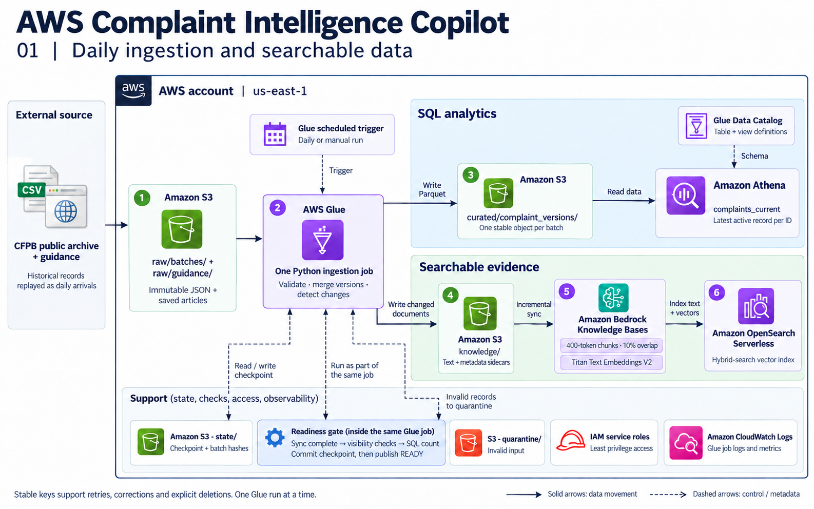
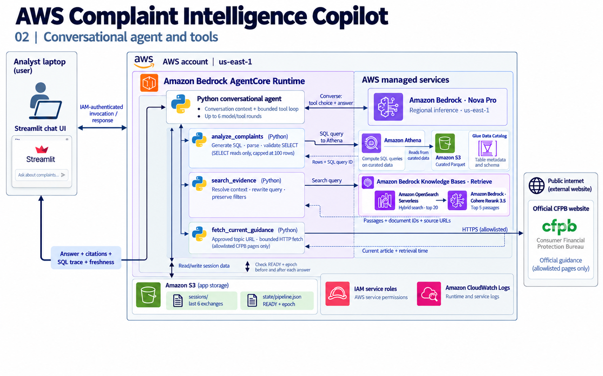

# AWS Complaint Intelligence Copilot

**An AWS data and AI application for daily complaint ingestion, SQL analytics, conversational RAG, OpenSearch hybrid retrieval, and reranking.**

Start with this document to understand the system. Follow [SETUP_AND_RUN.md](SETUP_AND_RUN.md) to create the AWS resources, upload the supplied data, run the pipeline, deploy the agent, and start a conversation.

## 1. Problem statement

An operations analyst needs to investigate consumer complaints. Structured fields can answer questions such as “Which issues occur most often?” Narrative descriptions explain the experiences consumers reported. Official guidance provides a separate, authoritative source of information.

You will build an assistant that:

1. Receives new complaint batches each day.
2. Updates both the analytics dataset and the searchable narrative collection.
3. Handles corrections, explicit deletions, retries, and incomplete refreshes.
4. Answers numerical questions using SQL.
5. Retrieves relevant complaint examples and saved guidance with citations.
6. Fetches current official guidance when the question requires fresh information.
7. Understands follow-up questions and combines multiple tools in one answer.
8. Exposes its sources, SQL, tool calls, and data freshness for inspection.

The user is an **internal analyst**. Consumer allegations are reported experiences, not verified findings about a company. Complaint volume alone does not measure customer satisfaction or prove a cause.

## 2. What is included

- Prepared complaint records extracted from an official CFPB archive.
- A deterministic 1,200-record credit-card complaint cohort.
- Two batches of original records and one clearly labelled correction/deletion batch.
- Extracted official CFPB article records containing saved text and approved live-fetch URLs.
- One Glue ingestion job, with a small S3 checkpoint.
- Athena SQL definitions for version history and the current-record view.
- Bedrock Knowledge Bases backed by **OpenSearch Serverless**, not S3 Vectors.
- A plain Python agent using Bedrock Converse and exactly three tool functions.
- An AgentCore entry point and a local Streamlit chat interface.
- Prepared IAM policy/trust JSON, Athena SQL, Glue settings, and a ready-to-upload Glue wheel and AgentCore ZIP. Only the account ID needs substitution in console setup values.

You create the AWS services manually through the console using the supplied setup artifacts and the setup guide.

**Deployment boundary:** the ingestion job, SQL execution, model calls, retrieval, and deployed agent run in AWS. Streamlit runs on your local machine and invokes the AWS agent with your AWS credentials. This repository does not expose an unauthenticated public website.

## 3. Data provenance and incremental ingestion

The primary source is the [CFPB Consumer Complaint Database Narratives Archive](https://www.consumerfinance.gov/foia-requests/foia-electronic-reading-room/cfpb-consumer-complaint-database-narratives-archive/), specifically the January–February 2025 CSV ZIP.

CFPB [ceased publishing narratives in its live database in August 2026](https://www.consumerfinance.gov/about-us/newsroom/the-cfpb-to-cease-discretionary-publication-of-complaint-narratives-and-visualizations/). Therefore:

- The included narratives are **real historical data**.
- The project **replays** them as daily arrivals.
- It does not claim to download newly published narratives every day.
- In a business implementation, the S3 input would come from the organization's daily complaint-system export.
- Synthetic corrections and deletions let you verify update and deletion handling; they are not attributed to consumers as original statements.

Each file in `data/batches/` contains its batch ID, sequence, description and complete records. Records retain their source URL and complaint date. The expected active counts are listed below; the archive URL and preparation logic are in [data_pipeline/prepare_data.py](data_pipeline/prepare_data.py).

| Input batch | Meaning | Expected active complaints |
|---|---|---:|
| `batch-001.json` | First 960 sampled original records | 960 |
| `batch-002.json` | Remaining 240 sampled original records | 1,200 |
| Retry either completed batch | Same immutable batch again | Unchanged |
| `batch-003.json` | Three labelled narrative corrections and one explicit deletion | 1,199 |

The sample is selected with random seed 42 and then sorted by source date and complaint ID. Use this fixed cohort to follow incremental changes and reconcile each ingestion run. It is not a representative estimate of the complete complaint population.

The 11 guidance articles come from the [CFPB credit-card resources page](https://www.consumerfinance.gov/consumer-tools/credit-cards/). Their extracted titles, URLs and text are supplied in `data/guidance/articles.json`. Use the prepared batches and article records for setup. The optional preparation script downloads the original ZIP and HTML if you need to rebuild the inputs; those downloads are not required for deployment.

## 4. Architecture A — daily data refresh

[](docs/architecture/daily-data-pipeline.png)

*Open the image to inspect the service labels and connections at full size.*

One Glue Python job performs the ingestion steps sequentially. The S3 icons represent separate prefixes in one private project bucket. Glue Data Catalog supplies schema metadata; Athena reads the Parquet data from S3.

### Daily processing, in order

1. Read the checkpoint and select the next immutable batch, or resume a failed batch.
2. Validate the complete batch. A malformed batch is rejected as a whole and written to quarantine.
3. Set the pipeline status to `UPDATING` before modifying either destination.
4. Write one deterministic Parquet object for the batch.
5. Merge the incoming versions into the small current-record checkpoint in memory.
6. Write only changed complaint documents and changed guidance articles.
7. Start a knowledge-base sync, wait for completion, and inspect document failures.
8. Probe changed logical document IDs through retrieval. Check expected versions or absence.
9. Query Athena and reconcile the active count against the merged records.
10. Commit the checkpoint and publish `READY`, the refresh epoch, source date range, and active count.

Only one Glue job may run at a time. This avoids competing checkpoint writers.

### How corrections and retries work

The raw input contract is deliberately small:

```json
{
  "batch_id": "batch-004",
  "sequence": 4,
  "description": "Next business export",
  "records": [
    {
      "complaint_id": "12345678",
      "date_received": "2025-02-15",
      "company": "Example company",
      "product": "Credit card",
      "issue": "Example issue",
      "state": "CA",
      "company_response": "Closed with explanation",
      "timely_response": "Yes",
      "narrative": "The complete narrative for this record version.",
      "source_url": "https://example.org/source",
      "record_version": 4,
      "is_deleted": false,
      "is_demo_fixture": true
    }
  ]
}
```

This example illustrates the input contract. Batches 1 and 2 contain original CFPB records; batch 3 contains explicitly labelled synthetic corrections and a deletion.

- Every batch contains **complete record versions**, not partial field patches.
- A new ID adds a complaint. An existing ID with a later version updates it.
- The supplied input batches use the increasing batch sequence as `record_version`.
- A deletion is an explicit record with `is_deleted=true`. A missing record in a delta is not a deletion.
- A completed batch cannot be edited. Its checksum is stored; corrections go into a new batch.
- A retry writes the same Parquet key and the same logical document paths.
- Source complaint dates are business dates, not change-detection watermarks.

For a production connector, map the source's revision information to this contract. The included replay does not implement arbitrary out-of-order change-data capture.

### Why there is both history and a current view

`complaint_versions` preserves every received version. `complaints_current` uses `ROW_NUMBER()` to choose the latest version per ID. It filters deleted records **after** ranking, so a deleted complaint's older version cannot reappear.

At this small scale, this is easy to inspect. As history grows, an Iceberg table or compacted current snapshot would reduce the cost of repeated ranking.

### How OpenSearch stays current

Each complaint uses the same S3 document path throughout its life:

```text
knowledge/complaints/12345678.txt
knowledge/complaints/12345678.txt.metadata.json
```

Bedrock Knowledge Bases owns chunk IDs and vector writes. The ingestion job updates the logical source document and starts synchronization. [Bedrock synchronization](https://docs.aws.amazon.com/bedrock/latest/userguide/kb-data-source-sync-ingest.html) processes added, modified, and deleted documents incrementally.

A record without a narrative remains in SQL but has no narrative document. One long narrative can produce several chunks, so **SQL row count and vector chunk count are not expected to match**.

The ingestion job leaves unchanged documents intact, avoiding unnecessary reprocessing caused by new daily timestamps.

### Failure behavior and the refresh window

| Pipeline condition | Agent behavior | Recovery |
|---|---|---|
| No completed ingestion | Data-backed answers are unavailable | Complete the first batch |
| Refresh in progress | New data-backed answers pause; an intervening epoch change invalidates an in-flight answer | Wait for synchronization, visibility checks and SQL reconciliation |
| Refresh failed | Partial results are not presented as a ready dataset | Fix the cause and rerun the same batch |
| Refresh complete | Answers use the committed dataset and include its freshness information | Process the next batch when available |

SQL and OpenSearch do not share a transaction. The agent checks `READY` and the refresh epoch before and after answering. A refresh that intervenes invalidates the answer. If a job fails, data-backed answers pause until recovery succeeds.

Visibility probes are practical readiness checks, not a guarantee of transaction isolation across every OpenSearch shard. A failed run can leave partially updated destinations; the stable keys and retained checkpoint make rerunning the same batch safe.

## 5. Architecture B — conversational AI

[](docs/architecture/conversational-agent.png)

*AgentCore hosts the Python conversation and tool code. The managed model, SQL and retrieval services are shown across its runtime boundary. The Streamlit UI runs on your local machine.*

### Tool decisions

| Question type | Tool | Source of truth |
|---|---|---|
| Counts, rankings, grouping, percentages | `analyze_complaints` | Executed Athena results |
| Examples, reported experiences, saved guidance | `search_evidence` | Retrieved passages |
| Current official guidance | `fetch_current_guidance` | Fetched page with retrieval time |
| A combined investigation | More than one tool | Clearly attributed evidence from each |

The agent is a bounded Converse loop, rather than a framework with hidden routing. It can make up to six model/tool rounds. Tool errors are returned to the model so it can explain the failure.

### Retrieval details

1. The agent resolves conversational references.
2. The evidence tool rewrites the standalone request as a search query.
3. Explicit company/product/date/source-type filters remain outside the rewrite.
4. OpenSearch retrieves up to 20 candidates using hybrid search.
5. Bedrock reranks and returns around five passages.
6. The model answers with complaint IDs or guidance IDs and source links.

Guidance requests do not inherit a company filter. There is no claim that a company's complaints establish what official guidance says.

### SQL controls

- The model receives only the small current-view schema.
- SQLGlot parses the generated query.
- Only a single SELECT against the unqualified `complaints_current` view is allowed.
- CTEs, commands, other tables and SELECT INTO are rejected.
- Returned rows are limited to 100.
- The Athena workgroup caps bytes scanned and the application cancels slow queries.
- IAM permissions limit data access and writes to the required result/session prefixes.
- Query-result reuse is disabled to make newly ingested data visible.

A row limit is not a scan-cost limit; the workgroup supplies the latter.

## 6. Data model

| Field | Raw / Parquet type | Meaning |
|---|---|---|
| `complaint_id` | string | Stable business key |
| `date_received` | ISO date string | CFPB business date; the view exposes DATE |
| `company` | string | Exact company label from the source |
| `product` | string | Financial product category |
| `issue` | string | Source issue category |
| `state` | string | State or `UNKNOWN` |
| `company_response` | string | Source response category |
| `timely_response` | string | Source Yes/No/empty value |
| `narrative` | string, raw/checkpoint only | Public narrative; not duplicated in the SQL table |
| `has_narrative` | boolean, Parquet | Whether a narrative is available |
| `record_version` | bigint | Increasing replay revision |
| `is_deleted` | boolean | Explicit tombstone |
| `is_demo_fixture` | boolean | Identifies a synthetic modification rather than an original source statement |
| `batch_id` | string, Parquet | Ingestion provenance |
| `source_url` | string, raw/checkpoint | Official archive/source link |

OpenSearch chunk metadata includes `document_id`, `source_type`, company, product, source date, numeric source date, record version, source URL, and fixture flag. Guidance uses its URL-derived document ID and a content hash.

`state/checkpoint.json` holds the last sequence, processed-batch hashes, current records and guidance hashes. It is suitable for this small cohort. `state/pipeline.json` is a separate compact status document read by the agent.

## 7. S3 layout

```text
raw/batches/                    Immutable daily JSON batches
raw/guidance/articles.json       Full catalog of saved official articles
curated/complaint_versions/      One Parquet file per batch
knowledge/complaints/            Current narrative documents and metadata
knowledge/guidance/              Current saved articles and metadata
state/checkpoint.json            Small-cohort ingestion checkpoint
state/pipeline.json              READY / UPDATING / FAILED + refresh epoch
quarantine/                     Rejected batch and validation reason
athena-results/                 Query result files
sessions/                       Completed conversation turns
code/                           Glue script, shared module and configuration
runtime/agent.zip               AgentCore deployment package
```

The knowledge base reads **only `knowledge/`**. Do not point it at the bucket root: raw batches, checkpoints, query results and session history are not retrieval documents.

## 8. Folder structure and code reference

Python files are grouped by responsibility. The root contains the two guides and local dependency list; prepared data, settings, application code, and deployment material each have their own folder.

```text
aws-complaint-copilot/
├── README.md                         Problem, architecture, data model and code reference
├── SETUP_AND_RUN.md                   Manual AWS setup and execution instructions
├── requirements.txt                  Local Python dependencies
├── docs/architecture/
│   ├── daily-data-pipeline.png        Generated AWS ingestion architecture
│   ├── conversational-agent.png       Generated AWS agent and tool architecture
│   └── imagegen-prompts.json          Exact final image-edit prompts
├── config/
│   └── config.json                   Fixed resource names and query settings
├── data_pipeline/
│   ├── prepare_data.py                Download, normalize and prepare replay batches
│   └── ingest.py                      Daily Glue workflow and recovery
├── conversational_agent/
│   ├── agent.py                       Conversation, tool loop and S3 session history
│   ├── tools.py                       SQL, retrieval and live-guidance functions
│   └── runtime.py                     AgentCore server entry point
├── shared/
│   ├── aws_helpers.py                 Configuration, S3 JSON, Athena and readiness
│   └── resource_lookup.py             Find AWS-assigned IDs by fixed resource names
├── app/
│   └── chat.py                        Streamlit chat interface
├── deployment/
│   ├── iam/                           Ready-to-paste trust and permission JSON
│   ├── glue/
│   │   ├── job-arguments.json        Exact Glue console job parameters
│   │   └── pyproject.toml            Shared-library wheel packaging metadata
│   ├── agentcore/runtime-settings.json Exact runtime console settings
│   ├── artifacts/
│   │   ├── complaint_copilot_shared-0.1.0-py3-none-any.whl
│   │   │                            Ready-to-upload shared library for Glue
│   │   └── agent.zip                 Ready-to-upload Python 3.11 ARM64 agent
│   ├── package_runtime.py            Optional maintainer rebuild after code edits
│   └── requirements-runtime.txt      Dependencies already included in agent.zip
├── sql/
│   └── tables.sql                     Version-history table and current-record view
└── data/
    ├── batches/                       Two arrival batches and one fixture batch
    └── guidance/articles.json         Saved text plus approved live-guidance URLs
```

Each Python folder also contains a small `__init__.py` explaining its role. `build/` is temporary packaging output; upload only the prepared wheel and ZIP in `deployment/artifacts/`. Leave `config/config.json` unchanged for setup. It already contains the selected names and contains no credentials. The code uses existing AWS authentication to resolve the account and AWS-assigned resource identifiers.

### Recommended reading order

| Step | File | What to follow in the code |
|---|---|---|
| 1 | [data_pipeline/prepare_data.py](data_pipeline/prepare_data.py) | Original ZIP → normalized records → deterministic sample → three batches |
| 2 | [shared/aws_helpers.py](shared/aws_helpers.py) | Configuration loading, S3 reads/writes, Athena polling and READY checks |
| 3 | [data_pipeline/ingest.py](data_pipeline/ingest.py) | Input selection, validation, Parquet, changed documents, sync, verification and commit |
| 4 | [conversational_agent/tools.py](conversational_agent/tools.py) | Each of the three tools and the schema exposed to the model |
| 5 | [conversational_agent/agent.py](conversational_agent/agent.py) | User message → tool request → tool result → final answer and saved history |
| 6 | [app/chat.py](app/chat.py) | How the UI invokes the same handler locally or through AWS |
| 8 | [shared/resource_lookup.py](shared/resource_lookup.py) | Paginated, read-only lookups of the named KB, data source and runtime |
| 9 | [deployment/package_runtime.py](deployment/package_runtime.py) | Optional maintainer rebuild of the Glue wheel and AgentCore ZIP; unnecessary during initial setup |
| 10 | [conversational_agent/runtime.py](conversational_agent/runtime.py) | Register the conversation handler with the AgentCore HTTP server |

Files start with an explanation of their role. Function docstrings describe inputs, returned values and important failure behavior. Numbered comments explain the workflow and why each AWS operation occurs. Dictionaries, function calls and control flow use consistent four-space indentation and expanded formatting.

### Run commands from the project root

Use module commands so Python can resolve the folder-based imports:

```bash
python -m streamlit run app/chat.py
```

Follow the setup guide before starting the chat: it uses your AWS services. Input batches, guidance records, policies, SQL and deployment packages are already prepared. Run `python -m data_pipeline.prepare_data` only if you intend to download the source data and rebuild the inputs, or `python -m deployment.package_runtime` to rebuild deployment packages after code changes.

### How the folders reach AWS

- **Glue:** upload `data_pipeline/ingest.py` as `code/ingest.py`. The supplied `deployment/artifacts/complaint_copilot_shared-0.1.0-py3-none-any.whl` already contains the `shared/` package, including AWS operations and resource-name lookups. Supply that wheel through **Python library path / `--extra-py-files`**. The wheel includes installation metadata for Glue Python shell; do not substitute a plain source ZIP.
- **AgentCore:** the supplied `deployment/artifacts/agent.zip` preserves `conversational_agent/`, `shared/`, `config/` and the small `data/guidance/articles.json` file. The live-guidance tool derives its topic/URL map from that existing article data. Its generated root file, `runtime_entrypoint.py`, imports `conversational_agent.runtime.main`. This launcher is a build artifact, not another loose source file.
- **Local UI:** run from the project root using the command above. Local Python mode imports the same application packages used in AWS; AWS AgentCore mode invokes the deployed runtime.

### Configuration

Use the supplied defaults for initial setup. Resource names, query behavior and timeouts are in `config/config.json`.

Leave the supplied file unchanged during setup. Create **complaint-copilot-kb**, its S3 source **complaint-documents**, and the AgentCore runtime **complaint_copilot** in **us-east-1**. The bucket is **complaint-copilot-ACCOUNT_ID-us-east-1**, where only **ACCOUNT_ID** is replaced by your account number in console setup.

The running code resolves the bucket account with [STS GetCallerIdentity](https://docs.aws.amazon.com/STS/latest/APIReference/API_GetCallerIdentity.html), then looks up service-assigned identifiers by name when needed. You can use the supplied ZIP without rebuilding it for your AWS account. The local credentials and service roles must belong to the same project account. Missing/duplicate names fail explicitly. [Bedrock resource lookup](https://docs.aws.amazon.com/bedrock/latest/APIReference/API_agent_ListKnowledgeBases.html), [AgentCore runtime lookup](https://docs.aws.amazon.com/bedrock-agentcore-control/latest/APIReference/API_ListAgentRuntimes.html).

The SQL, policies, job arguments and runtime settings are already filled in; replace **ACCOUNT_ID** only, as listed in step 6 of [SETUP_AND_RUN.md](SETUP_AND_RUN.md). KB IAM resources use an account/region-scoped wildcard because their IDs are assigned by AWS; these policies allow their listed KB operations across that account/region. The guide explains this scope. The existing article data supplies live-guidance URLs; no separate URL configuration is required.

| Setting | Purpose |
|---|---|
| `region`, `bucket` | Region and dedicated project storage |
| `knowledge_base_name`, `data_source_name` | Fixed names; resolve IDs when ingestion or retrieval needs them |
| `database`, `workgroup` | Athena schema and scan-cost boundary |
| `model_id`, `reranker_model_id` | Generation and reranking models |
| `agent_runtime_name` | Local UI finds the deployed runtime ARN by this fixed name |
| `retrieval_mode`, `rerank` | Hybrid/semantic search and reranking switch |
| `candidate_count`, `result_count` | Retrieve 20 candidates, keep up to five passages |
| `max_tool_rounds` | Bound the model/tool loop to six rounds |
| `athena_timeout_seconds` | Cancel an overlong SQL query |
| `ingestion_timeout_seconds` | Maximum wait for knowledge-base synchronization |
| `visibility_timeout_seconds` | Maximum wait for changed documents to appear/disappear |

## 9. Example conversation

After processing batch 2, ask these questions in order to check SQL analysis, retrieval, follow-up context, live guidance and unsupported requests:

1. “How many active complaints are in the loaded sample?”
2. “Which five companies received the most complaints?”
3. “For the first company, what are the most common issues?”
4. “Show examples describing those experiences for the same company.”
5. “Find complaints describing problems disputing a credit card charge.”
6. “What does the saved CFPB guidance say about disputing a charge?”
7. “Fetch the current official guidance on the same topic.”
8. “Combine the complaint counts, examples, and official guidance in a short analyst summary.”
9. “What is the actual customer satisfaction rate?” — explain the missing denominator.
10. “Delete these complaints.” — reject the requested write.

Then process batch 3. Ask for one of the corrected complaints (`11335237`, `11342596`, or `11343867`) from `data/batches/batch-003.json`, and search for `ORCHID-CORRECTION`. Check the SQL count drops from 1,200 to 1,199. Retry batch 3 and verify it stays 1,199.

## 11. Scope, costs, and operating limits

- All regional resources use **us-east-1 (N. Virginia)**. Cohere Rerank 3.5 supplies reranking through Amazon Bedrock in this region.
- Generation model: `amazon.nova-pro-v1:0` using regional invocation; embeddings: Titan Text Embeddings V2; reranker: `cohere.rerank-v3-5:0`. The supplied model-invocation permissions are scoped to us-east-1.
- The model can still choose a wrong tool or generate an incorrect query. Inspect the executed SQL, retrieved passages and citations in the chat's source and tool trace.
- The checkpoint is an in-memory/S3 representation of a small cohort. It is not intended for millions of records.
- The refresh gate accepts a short maintenance window to keep cross-store update behavior simple.
- Version history grows until compacted. The supplied dataset contains three batches.
- Sessions are for a single authenticated operator. Multi-user authorization and concurrent edits to one session are outside scope.
- The live tool can fail if the public site is unavailable or blocks requests. It reports the error and does not label an old snapshot as live.
- Source-page extraction is text-only. OCR and complex layout parsing are outside the implementation's scope.
- OpenSearch, model calls, reranking, Glue, Athena, AgentCore and S3 incur charges. OpenSearch has compute/storage pricing; inspect the console configuration and delete the project resources when you no longer need them. See [OpenSearch pricing](https://aws.amazon.com/opensearch-service/pricing/).

## 12. References

The two architecture images were created with the built-in imagegen tool and reviewed against this implementation. Their [final image-edit prompts and image checksums](docs/architecture/imagegen-prompts.json) are included for reproducibility. These are project illustrations, not official AWS reference diagrams.

- [CFPB archive](https://www.consumerfinance.gov/foia-requests/foia-electronic-reading-room/cfpb-consumer-complaint-database-narratives-archive/)
- [CFPB field definitions](https://cfpb.github.io/api/ccdb/fields.html)
- [Bedrock incremental synchronization](https://docs.aws.amazon.com/bedrock/latest/userguide/kb-data-source-sync-ingest.html)
- [Hybrid search and retrieval configuration](https://docs.aws.amazon.com/bedrock/latest/userguide/kb-test-config.html)
- [Reranking region/model support](https://docs.aws.amazon.com/bedrock/latest/userguide/rerank-supported.html)
- [AgentCore Python direct deployment](https://docs.aws.amazon.com/bedrock-agentcore/latest/devguide/runtime-get-started-code-deploy-python.html)
- [AWS reference architecture combining documents and SQL](https://aws.amazon.com/blogs/machine-learning/automate-chatbot-for-document-and-data-retrieval-using-amazon-bedrock-agents-and-knowledge-bases/)
